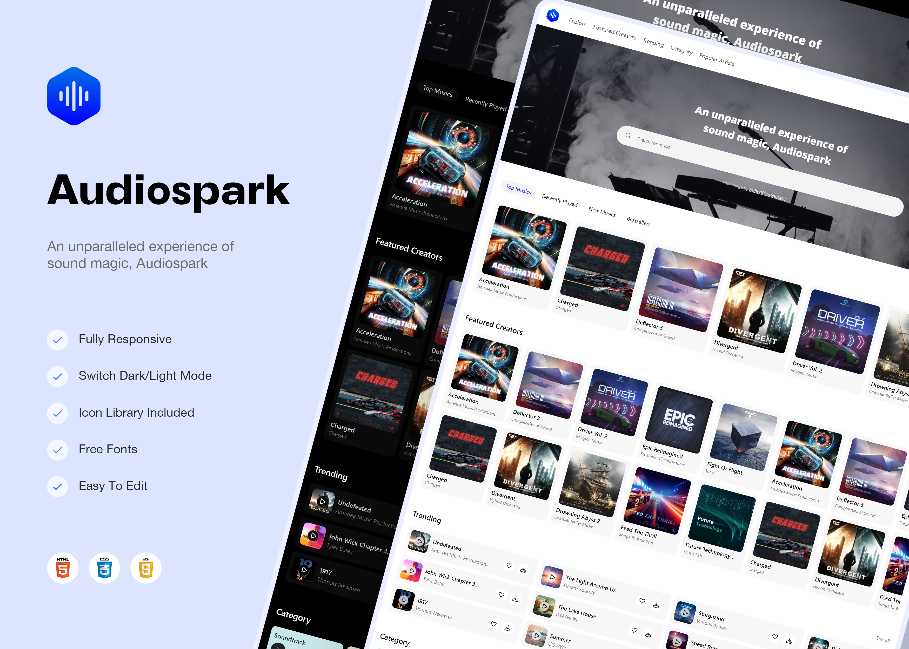

# AudioSpark

A music discovery interface built with HTML, CSS and JavaScript. Browse cover art in **Explore**, discover featured creators, or jump from trending tracks to popular artists.

  

## The interface

## Inside the artwork

A selection from the site's cover and artist collections. Open a thumbnail to see the full image.

| Charged | Fight or Flight | Hans Zimmer |
| :---: | :---: | :---: |
|  |  |  |

## Open locally

Download the repository, extract it, and open `index.html` in your browser.

## Design references

[Website UI on Dribbble](https://dribbble.com/shots/22940279-Audiospark-Website-Project) · [Logo design on Dribbble](https://dribbble.com/shots/22940194-Audiospark-Logo-Project)
